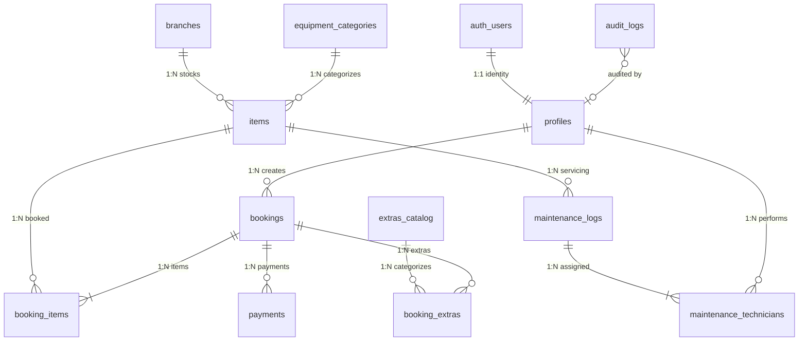

# Toolshed Rentals — Comprehensive Database Dictionary Catalog

**Course:** Advanced Database Systems (3rd Year IT Finals Block)  
**System:** Toolshed Rentals — Logistics, Warehouse & Equipment Rental Engine  
**Deployment Endpoint:** `https://ophgpdwzoeuheshcfrrc.supabase.co`  
**Database Engine:** PostgreSQL 15.x / 16.x (Cloud Instance via Supabase)  
**Design Standard:** Strict Third Normal Form (3NF)  

---

## 1. Schema Overview & Relational Architecture

The database architecture consists of **12 distinct, fully normalized tables** operating under strict referential integrity constraints, automated PL/pgSQL triggers, and Row Level Security (RLS) policies.

---

## 2. Table Catalogs & Specifications

### 2.1 `public.profiles`
Stores system user profiles, contact information, and role assignments directly tied to authentication credentials.

| Column | Type | Nullable | Default | Constraints / References | Description |
|---|---|:---:|---|---|---|
| `id` | `uuid` | NO | — | **PK**, `REFERENCES auth.users(id) ON DELETE CASCADE` | Unique user UUID mapped to auth. |
| `email` | `text` | YES | — | — | Contact email address. |
| `full_name` | `text` | YES | — | — | Complete legal name of customer or staff. |
| `phone` | `text` | YES | — | — | Philippine mobile contact number. |
| `role` | `public.app_role` | NO | `'customer'` | `CHECK (role IN ('customer', 'staff', 'admin'))` | Role tier for RBAC authorization. |
| `created_at` | `timestamptz` | NO | `now()` | — | Timestamp of registration. |

- **Indexes:** Primary key B-tree on `id`.
- **Triggers:** `trg_audit_profiles` (audit logging), `profiles_protect_role_change` (guards unauthorized role elevation).
- **RLS Policies:**
  - `profiles_select_own`: Users can view their own profile.
  - `profiles_select_staff`: Staff and admins can view profiles for booking lookups.
  - `profiles_update_own`: Users can edit their own contact details.
  - `profiles_update_admin`: Only admins can modify user roles.

---

### 2.2 `public.branches`
Physical warehouse and rental depot locations across Bohol.

| Column | Type | Nullable | Default | Constraints / References | Description |
|---|---|:---:|---|---|---|
| `id` | `uuid` | NO | `gen_random_uuid()` | **PK** | Unique branch identifier. |
| `name` | `text` | NO | — | **UNIQUE** | Branch name (`Tagbilaran`, `Panglao`, `Tubigon`). |
| `created_at` | `timestamptz` | NO | `now()` | — | Record creation timestamp. |

- **RLS Policies:** Authenticated users can SELECT; Staff and Admin can INSERT/UPDATE/DELETE.

---

### 2.3 `public.equipment_categories` (3NF Normalization Entity)
Classification of tools and machinery with mandatory safety guidelines.

| Column | Type | Nullable | Default | Constraints / References | Description |
|---|---|:---:|---|---|---|
| `id` | `uuid` | NO | `gen_random_uuid()` | **PK** | Category identifier. |
| `code` | `text` | NO | — | **UNIQUE** | Short code (`POWER`, `CUT`, `DEMO`, `HEAVY`). |
| `name` | `text` | NO | — | **UNIQUE** | Full category name. |
| `description` | `text` | YES | — | — | Category operational scope. |
| `safety_guidelines`| `text` | YES | — | — | Mandatory safety instructions. |
| `created_at` | `timestamptz` | NO | `now()` | — | Creation timestamp. |

- **RLS Policies:** Authenticated users can SELECT; Staff and Admin can manage.

---

### 2.4 `public.items`
Physical tool and machinery inventory units.

| Column | Type | Nullable | Default | Constraints / References | Description |
|---|---|:---:|---|---|---|
| `id` | `uuid` | NO | `gen_random_uuid()` | **PK** | Equipment item UUID. |
| `name` | `text` | NO | — | — | Equipment brand and model title. |
| `category` | `text` | NO | — | — | Category label (backward compatibility). |
| `category_id` | `uuid` | YES | — | `REFERENCES public.equipment_categories(id) ON DELETE SET NULL` | Normalized category reference. |
| `branch_id` | `uuid` | NO | — | `REFERENCES public.branches(id) ON DELETE RESTRICT` | Owning warehouse branch location. |
| `serial` | `text` | NO | — | **UNIQUE** | Equipment serial number / barcode. |
| `status` | `text` | NO | `'available'` | `CHECK (status IN ('available', 'rented_out', 'maintenance', 'damaged'))` | Current lifecycle state. |
| `daily_price` | `numeric(10,2)`| NO | — | `CHECK (daily_price >= 0)` | Base 24-hour rental rate in PHP. |
| `image_url` | `text` | YES | — | — | Equipment photographic asset URL. |
| `created_at` | `timestamptz` | NO | `now()` | — | Registration timestamp. |
| `updated_at` | `timestamptz` | NO | `now()` | — | Last modification timestamp. |

- **Indexes:** `idx_items_branch` (`branch_id`), `idx_items_category` (`category_id`).
- **Triggers:** `set_items_updated_at`, `trg_audit_items`.

---

### 2.5 `public.bookings`
Primary rental reservation and lifecycle order headers.

| Column | Type | Nullable | Default | Constraints / References | Description |
|---|---|:---:|---|---|---|
| `id` | `text` | NO | `'BK-' \|\| nextval(...)` | **PK** | Human-readable sequential booking ID. |
| `customer_id` | `uuid` | NO | — | `REFERENCES auth.users(id) ON DELETE CASCADE` | Renting customer user ID. |
| `item_id` | `uuid` | YES | — | `REFERENCES public.items(id) ON DELETE RESTRICT` | Primary item link (backward compat). |
| `start_at` | `timestamptz` | NO | — | `CHECK (end_at > start_at)` | Rental dispatch start date and time. |
| `end_at` | `timestamptz` | NO | — | — | Rental scheduled return date and time. |
| `daily_rate` | `numeric(10,2)`| NO | `0` | `CHECK (daily_rate >= 0)` | Effective daily rental charge. |
| `rental_days` | `integer` | NO | `1` | `CHECK (rental_days >= 1)` | Total calculated rental duration. |
| `rental_subtotal`| `numeric(10,2)`| NO | `0` | `CHECK (rental_subtotal >= 0)` | Base rental charge before add-ons. |
| `extras_total` | `numeric(10,2)`| NO | `0` | `CHECK (extras_total >= 0)` | Cumulative cost of accessories/services. |
| `total` | `numeric(10,2)`| NO | `0` | `CHECK (total >= 0)` | Final contractual payable amount. |
| `status` | `text` | NO | `'reserved'` | `CHECK (status IN ('reserved', 'checked_out', 'returned', 'cancelled'))` | Booking operational state. |
| `payment_status` | `text` | NO | `'unpaid'` | `CHECK (payment_status IN ('unpaid', 'partial', 'paid'))` | Financial settlement state. |
| `condition_notes`| `text` | YES | — | — | Equipment check-out dispatch notes. |
| `return_notes` | `text` | YES | — | — | Equipment check-in return notes. |
| `is_damaged` | `boolean` | NO | `false` | — | Flag indicating damage upon return. |
| `created_at` | `timestamptz` | NO | `now()` | — | Booking initiation timestamp. |
| `updated_at` | `timestamptz` | NO | `now()` | — | Last record update timestamp. |

- **Exclusion Constraint:** `prevent_overlapping_bookings` using GiST on `item_id WITH =` and `tstzrange(start_at, end_at, '[)') WITH &&`. Prevents double booking conflicts at the database engine level.
- **Indexes:** `idx_bookings_item_dates` (`item_id, start_at, end_at`), `idx_bookings_customer` (`customer_id`).
- **Triggers:** `set_bookings_updated_at`, `trg_audit_bookings`.

---

### 2.6 `public.booking_items` (MANDATORY N:M JUNCTION TABLE 1)
Resolves the **Many-to-Many** relationship between **Bookings** and **Items**, storing item-level operational details.

| Column | Type | Nullable | Default | Constraints / References | Description |
|---|---|:---:|---|---|---|
| `id` | `uuid` | NO | `gen_random_uuid()` | **PK** | Junction record identifier. |
| `booking_id` | `text` | NO | — | `REFERENCES public.bookings(id) ON DELETE CASCADE` | Associated booking manifest. |
| `item_id` | `uuid` | NO | — | `REFERENCES public.items(id) ON DELETE RESTRICT` | Assigned physical equipment unit. |
| `daily_rate_at_booking` | `numeric(10,2)` | NO | — | `CHECK (daily_rate_at_booking >= 0)` | Price lock snapshot at booking time. |
| `quantity` | `integer` | NO | `1` | `CHECK (quantity >= 1)` | Quantity of tool items. |
| `item_condition_out` | `text` | YES | `'good'` | — | Dispatch condition assessment. |
| `item_condition_in` | `text` | YES | — | — | Check-in returned inspection note. |
| `checked_out_at` | `timestamptz` | YES | — | — | Actual physical release timestamp. |
| `returned_at` | `timestamptz` | YES | — | — | Actual physical return timestamp. |
| `is_damaged` | `boolean` | NO | `false` | — | Specific damage flag for this unit. |
| `created_at` | `timestamptz` | NO | `now()` | — | Junction creation timestamp. |

- **Constraints:** `uq_booking_item UNIQUE (booking_id, item_id)`.
- **Indexes:** `idx_booking_items_booking` (`booking_id`), `idx_booking_items_item` (`item_id`).
- **Triggers:** `trg_audit_booking_items`.

---

### 2.7 `public.extras_catalog`
Standardized catalog of accessories, safety equipment, fuel packages, and insurance options.

| Column | Type | Nullable | Default | Constraints / References | Description |
|---|---|:---:|---|---|---|
| `id` | `uuid` | NO | `gen_random_uuid()` | **PK** | Catalog item identifier. |
| `code` | `text` | NO | — | **UNIQUE** | Unique catalog code (`DELIV-TAG`, `INS-BASIC`). |
| `extra_type` | `text` | NO | — | `CHECK (extra_type IN ('delivery', 'insurance', 'safety_gear', 'accessory', 'fuel_pack', 'other'))` | Category of add-on service. |
| `name` | `text` | NO | — | — | Public product/service title. |
| `base_price` | `numeric(10,2)`| NO | — | `CHECK (base_price >= 0)` | Standard unit price in PHP. |
| `description` | `text` | YES | — | — | Service parameters and coverage. |
| `is_active` | `boolean` | NO | `true` | — | Availability status for rentals. |
| `created_at` | `timestamptz` | NO | `now()` | — | Catalog entry timestamp. |

---

### 2.8 `public.booking_extras` (N:M JUNCTION TABLE 2)
Resolves the **Many-to-Many** relationship between **Bookings** and **Extras Catalog**.

| Column | Type | Nullable | Default | Constraints / References | Description |
|---|---|:---:|---|---|---|
| `id` | `uuid` | NO | `gen_random_uuid()` | **PK** | Line item UUID. |
| `booking_id` | `text` | NO | — | `REFERENCES public.bookings(id) ON DELETE CASCADE` | Associated rental reservation. |
| `catalog_id` | `uuid` | YES | — | `REFERENCES public.extras_catalog(id) ON DELETE SET NULL` | Reference to standardized catalog. |
| `extra_type` | `text` | NO | — | `CHECK (extra_type IN ('delivery', 'insurance', 'safety_gear', 'accessory', 'fuel_pack', 'other'))` | Type classification snapshot. |
| `name` | `text` | NO | — | — | Descriptive service name. |
| `quantity` | `integer` | NO | `1` | `CHECK (quantity >= 1)` | Number of units ordered. |
| `price` | `numeric(10,2)`| NO | — | `CHECK (price >= 0)` | Price charged per unit. |
| `created_at` | `timestamptz` | NO | `now()` | — | Addition timestamp. |

- **Indexes:** `idx_booking_extras_booking` (`booking_id`), `idx_booking_extras_catalog` (`catalog_id`).

---

### 2.9 `public.payments`
Financial transactions and payment ledger.

| Column | Type | Nullable | Default | Constraints / References | Description |
|---|---|:---:|---|---|---|
| `id` | `uuid` | NO | `gen_random_uuid()` | **PK** | Transaction receipt UUID. |
| `booking_id` | `text` | NO | — | `REFERENCES public.bookings(id) ON DELETE CASCADE` | Target booking identifier. |
| `customer_id` | `uuid` | NO | — | `REFERENCES auth.users(id) ON DELETE CASCADE` | Remitting customer UUID. |
| `amount` | `numeric(10,2)`| NO | — | `CHECK (amount > 0)` | Settled payment amount in PHP. |
| `method` | `text` | NO | — | `CHECK (method IN ('cash', 'gcash', 'card', 'bank_transfer'))` | Payment channel. |
| `paid_at` | `timestamptz` | NO | `now()` | — | Time of payment settlement. |
| `recorded_by` | `uuid` | YES | — | `REFERENCES auth.users(id) ON DELETE SET NULL` | Staff member who received funds. |
| `created_at` | `timestamptz` | NO | `now()` | — | Transaction log timestamp. |

- **Indexes:** `idx_payments_booking` (`booking_id`), `idx_payments_customer` (`customer_id`).
- **Triggers:** `trg_audit_payments`.

---

### 2.10 `public.maintenance_logs`
Equipment servicing, repairs, and inspection records.

| Column | Type | Nullable | Default | Constraints / References | Description |
|---|---|:---:|---|---|---|
| `id` | `uuid` | NO | `gen_random_uuid()` | **PK** | Service ticket UUID. |
| `item_id` | `uuid` | NO | — | `REFERENCES public.items(id) ON DELETE CASCADE` | Equipment being serviced. |
| `description` | `text` | NO | — | — | Detailed maintenance diagnosis. |
| `status` | `text` | NO | `'completed'` | `CHECK (status IN ('scheduled', 'in_progress', 'completed', 'cancelled'))` | Maintenance progress state. |
| `hours_spent` | `numeric(5,2)` | NO | `0` | `CHECK (hours_spent >= 0)` | Labor hours dedicated. |
| `performed_at`| `date` | NO | `current_date` | — | Date maintenance took place. |
| `performed_by`| `uuid` | YES | — | `REFERENCES auth.users(id) ON DELETE SET NULL` | Lead technician user reference. |
| `staff_name` | `text` | YES | — | — | Name of technician. |
| `created_at` | `timestamptz` | NO | `now()` | — | Record created timestamp. |

- **Indexes:** `idx_maintenance_logs_item` (`item_id`).
- **Triggers:** `trg_audit_maintenance_logs`.

---

### 2.11 `public.maintenance_technicians` (MANDATORY N:M JUNCTION TABLE 3)
Resolves the **Many-to-Many** relationship between **Maintenance Work Orders** and **Staff Technicians**, tracking hours, assignments, and safety sign-offs.

| Column | Type | Nullable | Default | Constraints / References | Description |
|---|---|:---:|---|---|---|
| `id` | `uuid` | NO | `gen_random_uuid()` | **PK** | Work assignment UUID. |
| `maintenance_id` | `uuid` | NO | — | `REFERENCES public.maintenance_logs(id) ON DELETE CASCADE` | Associated maintenance work order. |
| `technician_id` | `uuid` | NO | — | `REFERENCES auth.users(id) ON DELETE CASCADE` | Staff member assigned to job. |
| `assigned_role` | `text` | NO | — | `CHECK (assigned_role IN ('lead_technician', 'assistant_technician', 'safety_inspector', 'quality_auditor'))` | Specialized role on this job. |
| `hours_logged` | `numeric(5,2)` | NO | `0` | `CHECK (hours_logged >= 0)` | Exact hours spent by technician. |
| `task_notes` | `text` | YES | — | — | Specific work performed by technician. |
| `sign_off_status`| `text`| NO | `'pending'` | `CHECK (sign_off_status IN ('pending', 'approved', 'rejected'))` | Safety compliance clearance. |
| `signed_off_at` | `timestamptz` | YES | — | — | Timestamp of inspection sign-off. |
| `assigned_at` | `timestamptz` | NO | `now()` | — | Work order assignment timestamp. |

- **Constraints:** `uq_maint_tech_role UNIQUE (maintenance_id, technician_id, assigned_role)`.
- **Indexes:** `idx_maint_tech_maintenance` (`maintenance_id`), `idx_maint_tech_user` (`technician_id`).

---

### 2.12 `public.audit_logs` (AUTOMATED ENGINE-LEVEL AUDITING ENTITY)
Tamper-proof system audit log written exclusively by server-side PL/pgSQL database triggers.

| Column | Type | Nullable | Default | Constraints / References | Description |
|---|---|:---:|---|---|---|
| `id` | `uuid` | NO | `gen_random_uuid()` | **PK** | Audit entry UUID. |
| `table_name` | `text` | NO | — | — | Name of mutated database table. |
| `record_id` | `text` | NO | — | — | Primary key of mutated row. |
| `action` | `text` | NO | — | `CHECK (action IN ('INSERT', 'UPDATE', 'DELETE'))` | SQL DML operation executed. |
| `old_data` | `jsonb` | YES | — | — | Complete pre-mutation row snapshot. |
| `new_data` | `jsonb` | YES | — | — | Complete post-mutation row snapshot. |
| `changed_fields`| `text[]`| YES | — | — | Array of modified column keys. |
| `performed_by` | `uuid` | YES | — | `REFERENCES auth.users(id) ON DELETE SET NULL` | UUID of user triggering action. |
| `client_ip` | `text` | YES | — | — | Network origin (if forwarded). |
| `created_at` | `timestamptz` | NO | `now()` | — | Immutable audit timestamp. |

- **Security & Integrity:** `REVOKE INSERT, UPDATE, DELETE FROM anon, authenticated`. Rows can only be created by `SECURITY DEFINER` trigger functions.
- **Indexes:** `idx_audit_logs_table_record` (`table_name, record_id`), `idx_audit_logs_created_at` (`created_at DESC`), `idx_audit_logs_performed_by` (`performed_by`).
- **RLS Policies:** `audit_logs_select_admin` (strictly viewable only by administrators; regular staff and customers cannot access).
